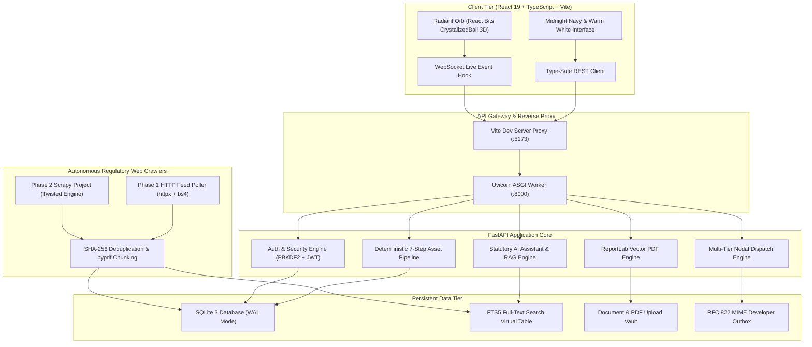
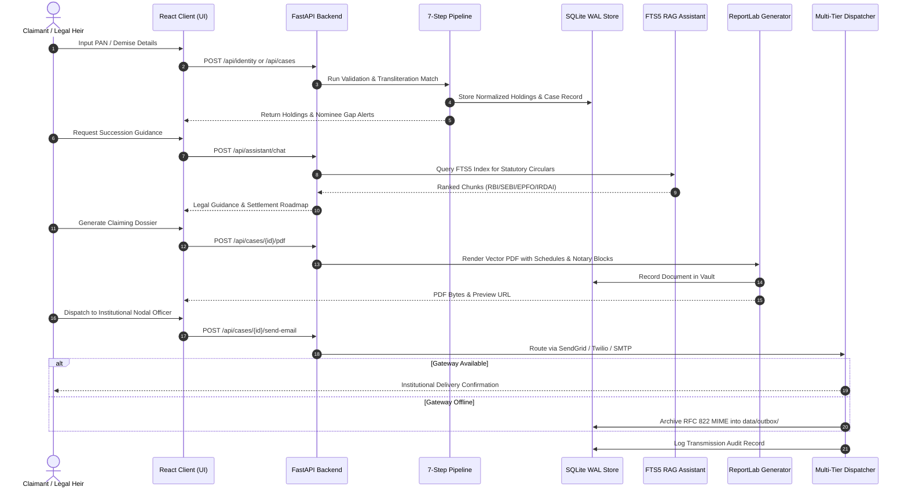

# Asset Bridge
### Unified Financial Twin and Autonomous Succession Engine for Indian Families
**Dexathon 2026 -- National Finalist Project**

[](https://fastapi.tiangolo.com)
[](https://react.dev)
[](https://www.typescriptlang.org)
[](https://tailwindcss.com)
[-brightgreen.svg)]()
[](https://www.python.org)
[](https://www.sqlite.org)

---

## 1. Executive Summary

Over **Rs. 94,000 Crore** in financial assets remains dormant and unclaimed across Indian institutions:
* **Reserve Bank of India (RBI)**: Unclaimed bank deposits, dormant savings accounts, and Depositor Education and Awareness (DEA) Fund balances.
* **Securities and Exchange Board of India (SEBI)**: Unclaimed dividends, Investor Education and Protection Fund (IEPF) transmissions, and un-transmitted mutual fund/demat folios.
* **Employees' Provident Fund Organisation (EPFO)**: Inoperative PF accounts, Employee Deposit Linked Insurance (EDLI) benefits, and pension balances.
* **Insurance Regulatory and Development Authority of India (IRDAI)**: Unpaid matured policies and delayed death claim settlements across life and general insurers.
* **Pension Fund Regulatory and Development Authority (PFRDA)**: Unclaimed National Pension System (NPS) Tier-I and Tier-II subscriber accumulations.
* **Department of Posts (India Post)**: Dormant Post Office Savings Bank (POSB) accounts, Public Provident Fund (PPF), National Savings Certificates (NSC), and Kisan Vikas Patra (KVP).

When an individual passes away in India, **no statutory mechanism connects civil death registrations to institutional wealth**. Surviving families navigate fragmented legal requirements across municipal revenue offices, sub-registrar desks, civil courts, and institutional nodal desks.

**Asset Bridge** establishes a two-sided financial twin that operates continuously across two life stages:
1. **Pre-Loss (Wealth Governance & Risk Prevention)**: Aggregates holdings under ReBIT-style Account Aggregator consent, continuously audits nomination integrity across all seven regulators, detects dormant exposure, and models multi-generational stochastic wealth paths.
2. **Post-Loss (Autonomous Succession Execution)**: Ingests death events from the Civil Registration System (CRS), identifies eligible legal heirs under the Hindu Succession Act (HSA 1956) or Indian Succession Act (ISA 1925), calculates exact statutory entitlement shares, and generates official, institution-ready legal claiming dossiers in vector PDF format with automated nodal officer dispatch.

---

## 2. Technical System Architecture

Asset Bridge is architected as an asynchronous, event-driven platform separating client presentation, high-throughput backend services, autonomous regulatory web scrapers, and persistent SQLite storage.



---

## 3. End-to-End Succession Workflow

The diagram below illustrates the complete sequence from initial identity verification to institutional nodal officer claim settlement:



---

## 4. Core Engineering Subsystems

### 4.1 The Deterministic 7-Step Asset Processing Pipeline

All ingested asset data flows through a deterministic, auditable seven-stage pipeline defined in `app/aggregation/pipeline.py`:

```
[ Step 1: Input Validation ]
      | Enforces strict PAN regex (^[A-Z]{5}[0-9]{4}[A-Z]$).
      | Validates fourth-character entity code ('P' for Individual, 'H' for HUF, 'F' for Firm).
      v
[ Step 2: Identity & Transliteration Matching ]
      | Calculates Jaro-Winkler string similarity and Soundex phonetic distance.
      | Prevents false merges: Partial matches (e.g. 'R. Raghavan' vs 'Raghavan Sundaram')
      | are scored at 0.65 confidence and isolated into unverified review buckets.
      v
[ Step 3: Multi-Regulator Discovery ]
      | Queries records across all seven statutory regulators:
      | RBI, SEBI, IRDAI, EPFO, PFRDA, IEPFA, and India Post.
      v
[ Step 4: Asset Normalization ]
      | Maps heterogenous source formats into uniform NormalizedAsset Pydantic models.
      | Standardizes monetary currencies into INR and parses dates into ISO-8601.
      v
[ Step 5: Non-Destructive Duplicate Detection ]
      | Compares account numbers, IFSC codes, DP-IDs, and folio references.
      | Identifies duplicates (isDuplicate=True, duplicateOf=primary.id) without
      | destroying raw institutional feeds, preserving a full regulatory audit trail.
      v
[ Step 6: Nominee Risk & Statutory Compliance Auditing ]
      | Identifies critical succession failure points:
      | - Unnominated accounts (mandating civil court succession certificates).
      | - Deceased nominees requiring urgent testamentary rectification.
      | - Minor nominees without designated statutory guardians.
      | - Balances exceeding state summary settlement thresholds (e.g., above Rs. 5 Lakhs).
      v
[ Step 7: Consolidated Reporting & Clean Total Calculation ]
      | Computes verifiableTotal strictly across unique, confirmed assets.
      | Outputs structured ConsolidatedReport with complete limitation disclosures.
```

### 4.2 SQLite 3 Storage & FTS5 Full-Text Search Engine

Asset Bridge employs a high-concurrency SQLite storage architecture optimized for zero-dependency portability and sub-millisecond retrieval:
* **Write-Ahead Logging (WAL)**: Enabled via `PRAGMA journal_mode=WAL`, separating concurrent read and write operations so read queries are never blocked by database transactions.
* **ACID Safety**: Enforces `PRAGMA foreign_keys=ON`, `PRAGMA synchronous=NORMAL`, and a `busy_timeout` of 5,000 milliseconds to manage concurrent multi-process access.
* **FTS5 Virtual Search Index**: The `document_chunks_fts` table indexes regulatory circulars and uploaded evidence:
  ```sql
  CREATE VIRTUAL TABLE document_chunks_fts USING fts5(
      chunk_id UNINDEXED,
      document_id UNINDEXED,
      content,
      regulator,
      circular_no,
      tags,
      tokenize = 'porter unicode61'
  );
  ```
* **BM25 Retrieval**: RAG queries utilize SQLite's native BM25 relevance scoring to rank statutory circular paragraphs against user questions.

### 4.3 Multi-Tier Nodal Communication Engine

To ensure official claiming packets reach institutional nodal desks reliably regardless of network or credential state, `app/core/mailer.py` implements a four-tier dispatch hierarchy:

| Tier | Provider | Protocol | Authentication | Attachment Encoding |
|---|---|---|---|---|
| **Tier 1** | Twilio SendGrid v3 | HTTPS REST (`/v3/mail/send`) | API Key (Bearer) | Base64 in JSON payload |
| **Tier 2** | Twilio Comms Email | HTTPS REST (`/v1/Emails`) | Account SID + Auth Token (Basic) | Multi-part form payload |
| **Tier 3** | Direct SMTP | TLS / SSL Socket (Ports 465 / 587) | Google App Password (16-char) | RFC 2045 MIME attachment |
| **Tier 4** | Developer Outbox | Filesystem Write (`data/outbox/`) | File system permissions | Raw RFC 822 MIME `.eml` |

Every transmission attempt generates an audit record in the `email_transmissions` table:
```sql
CREATE TABLE email_transmissions (
    id TEXT PRIMARY KEY,
    case_id TEXT,
    recipient_email TEXT NOT NULL,
    subject TEXT NOT NULL,
    provider TEXT NOT NULL,
    status TEXT NOT NULL,
    error_message TEXT,
    outbox_file TEXT,
    sent_at TEXT NOT NULL
);
```

### 4.4 ReportLab Vector PDF Engine

The dossier generator (`app/aggregation/pdf_generator.py`) produces publication-grade, court-admissible legal packets:
* **Two-Pass Page Numbering**: Implements a custom `NumberedCanvas` class that records total page counts during pass 1 and draws `Page X of Y` headers and footers during pass 2.
* **Document Structure**:
  1. **Executive Cover**: Asset Bridge brand horizon, case identifier, and official seal.
  2. **Deceased Profile**: Name, date of demise, place of death, and municipal death certificate registration details.
  3. **Schedule of Assets**: Institution-by-institution breakdown including account types, masked identifiers, branches, and values.
  4. **Legal Heir Apportionment**: Table of heirs with relationships, PAN numbers, and percentage entitlement shares calculated under statutory succession laws.
  5. **Statutory Claim Forms**: Auto-filled institutional claim templates (e.g. Form 20 for EPF, Form A for LIC, DA-2 for Banks).
  6. **Affidavit & Indemnity Block**: Notary signing schedules, witness blocks, and formal legal declarations.

### 4.5 Autonomous Regulatory Web Crawler Framework

The crawler subsystem monitors Indian government and regulatory portals for updates to claim procedures, interest delay penalties, and nomination thresholds:

* **Phase 1 Poller (`scripts/poll_regulations.py`)**:
  - Lightweight runner using `httpx` and `BeautifulSoup4`.
  - Rapidly polls index tables on RBI, SEBI, and EPFO.
* **Phase 2 Scrapy Project (`scrapers/`)**:
  - Asynchronous crawling using Twisted event reactors across four dedicated spiders:
    - `rbi_notifications`: Scrapes RBI notification feeds for Master Directions on Deceased Depositors (mandating 15-day settlement and Bank Rate + 4% delay penalties).
    - `sebi_circulars`: Extracts demat and mutual fund transmission threshold revisions.
    - `epfo_circulars`: Ingests Form 20 updates, composite death claim rules, and EDLI ceiling shifts.
    - `irdai_circulars`: Monitors Policyholder Protection regulations and delay interest penalty guidelines.
  - **Auto-Throttling & Politeness**: Scrapy's `AutoThrottle` and random request jitter prevent IP blocks on government servers.
  - **Deduplication Pipeline**: Computes SHA-256 hashes against existing records in SQLite `user_documents`. Newly detected circulars are processed through `pypdf`, segmented into 800-character chunks with 150-character overlap, and indexed directly into the SQLite FTS5 table.

---

## 5. Multi-Regulator Statutory Framework

Asset Bridge operates across all major Indian financial and revenue regulatory frameworks:

| Regulator | Act / Statutory Framework | Key Governed Procedures | Statutory Settlement Benchmark |
|---|---|---|---|
| **RBI** | Banking Regulation Act, 1949 (Sec 45ZA to 45ZF) | Deceased depositor accounts, locker operations, survivorship clauses | **15 calendar days**; delay attracts Bank Rate + 4% interest |
| **SEBI** | SEBI (LODR) Regulations, 2015 & Circulars | Mutual fund folios, CDSL/NSDL demat shares, IEPF-5 transmission | Simplified transmission up to **Rs. 5 Lakh** without probate |
| **EPFO** | Employees' Provident Funds Act, 1952 | Form 20 death settlement, Form 10D monthly pension, EDLI life insurance | Form 20 settlement within **7 working days** |
| **IRDAI** | Insurance Act, 1938 & Policyholder Regulations | Death claims, nominee discharges, suicide exclusion clauses | **30 days**; delay attracts Bank Rate + 2% penal interest |
| **PFRDA** | PFRDA Act, 2013 | NPS Tier-I lump-sum withdrawal and default 80% annuity allocations | Subscriber death exit settlement within **15 days** |
| **IEPFA** | Companies Act, 2013 (Sec 124 & 125) | Transmission of shares and unpaid dividends transferred to IEPF | Web-based Form IEPF-5 processing |
| **India Post** | Government Savings Promotion Act, 1873 | POSB, PPF, NSC, Senior Citizen Savings Scheme (SCSS) claims | Tahsildar certificate ceiling: **Rs. 5 Lakh** |

---

## 6. Monorepo Directory Structure

```
dexathon2026/
├── client/                           # React 19 Frontend Application (:5173)
│   ├── public/                       # Static public assets and favicon
│   ├── src/
│   │   ├── components/               # Domain UI cards, dialogs, charts & navigation
│   │   │   ├── reactbits/            # Visual widgets (CrystalizedBall, CursorGrid, PillNav)
│   │   │   ├── EmailDossierModal.tsx # Live nodal officer email dispatch modal
│   │   │   ├── GuideChat.tsx         # AI statutory chatbot with Radiant Orb UI
│   │   │   ├── LogoMark.tsx          # Official Asset Bridge brand geometry
│   │   │   ├── CaseBody.tsx          # Succession roadmap & PDF dossier viewer
│   │   │   └── ui.tsx                # Design system primitives & status indicators
│   │   ├── lib/                      # Type-safe API client, WebSocket hooks & formatters
│   │   │   ├── api.ts                # Client API interface (Cases, Dossiers, Crawlers)
│   │   │   ├── auth.tsx              # JWT context provider and session state
│   │   │   └── format.ts             # Strict INR formatting and date utilities
│   │   ├── pages/                    # 14 Full application views (Verify, Aggregate, Alerts, etc.)
│   │   └── index.css                 # Midnight Navy & Warm White design system
│   └── vite.config.ts                # Reverse-proxy routes for /api and /ws
├── fastapi-backend/                  # High-Throughput FastAPI REST & WebSocket Backend (:8000)
│   ├── app/
│   │   ├── core/                     # Foundational infrastructure & security
│   │   │   ├── auth.py               # PBKDF2 hashing, JWT signing, security dependencies
│   │   │   ├── db.py                 # SQLite WAL connection pool & pragma enforcement
│   │   │   ├── identity.py           # Indian statutory identity verification (PAN, Aadhaar)
│   │   │   ├── live.py               # Real-time WebSocket event broadcaster
│   │   │   ├── mailer.py             # Multi-tier email dispatch engine & audit logger
│   │   │   ├── routers.py            # Authentication, demo seeding, and outbox APIs
│   │   │   ├── schema.sql            # Relational DDL schema + FTS5 full-text index
│   │   │   ├── seeder.py             # Deterministic persona data generator
│   │   │   └── store.py              # Thread-safe ACID document and key-value store
│   │   ├── aggregation/              # Financial pipeline & succession intelligence
│   │   │   ├── assistant.py          # Gemini AI legal assistant with RAG fallback
│   │   │   ├── documents.py          # Regulatory Document Vault, chunking & FTS5 search
│   │   │   ├── mock_generator.py     # Procedural multi-regulator portfolio generator
│   │   │   ├── models.py             # Pydantic domain models for assets and claims
│   │   │   ├── pdf_generator.py      # ReportLab statutory claiming dossier PDF engine
│   │   │   ├── personas.py           # Demographic and financial catalog for 5 Indian personas
│   │   │   ├── pipeline.py           # Deterministic 7-step asset processing pipeline
│   │   │   └── routers.py            # Holdings, cases, consents, heirs, and PDF APIs
│   │   ├── ai_bot/                   # Statutory assistant knowledge retriever
│   │   └── config.py                 # Environment variables and path resolution
│   ├── data/                         # Persistent operational storage
│   │   ├── asset_bridge.db           # SQLite database in Write-Ahead Logging (WAL) mode
│   │   ├── outbox/                   # Local RFC 822 MIME archive (.eml files)
│   │   └── uploads/                  # User evidence, uploaded documents, and generated PDFs
│   ├── knowledge/                    # 8 Authoritative statutory regulatory guides (Markdown)
│   └── tests/                        # 29-suite automated backend test harness
├── scrapers/                         # Autonomous Statutory Crawler Suite
│   ├── scrapers/
│   │   ├── spiders/                  # Twisted/Asyncio spiders (RBI, SEBI, EPFO, IRDAI)
│   │   ├── items.py                  # Scrapy item schemas for circulars & notifications
│   │   ├── pipelines.py              # Ingestion pipeline routing directly to SQLite vault
│   │   └── settings.py               # Throttling, request jitter, and politeness policies
│   ├── runner.py                     # Concurrent multi-spider orchestrator
│   └── scrapy.cfg                    # Scrapy project configuration
├── scripts/                          # Monorepo management and platform runners
│   ├── poll_regulations.py           # Phase 1 lightweight statutory HTTP poller
│   └── run-python.js                 # Cross-platform .venv execution wrapper
├── BACKEND_ARCHITECTURE.md           # In-depth technical architecture and API manual
└── package.json                      # Monorepo workspace commands
```

---

## 7. Quick Start & Execution

### Prerequisites
* **Node.js**: v20 or higher
* **Python**: 3.11 to 3.14
* **Operating System**: Windows, Linux, or macOS

### Installation & Launch

1. **Clone the repository**:
   ```bash
   git clone https://github.com/Saisrikar20/ASSET-BRIDGE.git
   cd ASSET-BRIDGE
   ```

2. **Install Node.js dependencies**:
   ```bash
   npm install
   npm --prefix client install
   ```

3. **Configure Python virtual environment**:
   ```bash
   # Windows PowerShell
   python -m venv .venv
   .venv\Scripts\pip install -r fastapi-backend/requirements.txt

   # Linux / macOS
   python3 -m venv .venv
   source .venv/bin/activate
   pip install -r fastapi-backend/requirements.txt
   ```

4. **Launch development servers**:
   ```bash
   npm run dev
   ```

   * **Web Application**: `http://localhost:5173`
   * **Interactive API Documentation (Swagger)**: `http://127.0.0.1:8000/docs`
   * **Alternative API Documentation (ReDoc)**: `http://127.0.0.1:8000/redoc`

---

## 8. Complete Command Reference

| Command | Subsystem | Action |
|---|---|---|
| `npm run dev` | Full Stack | Runs FastAPI backend (:8000) and Vite frontend (:5173) concurrently |
| `npm run dev:backend` | Backend | Runs Uvicorn development server with live reload on port 8000 |
| `npm run dev:frontend` | Frontend | Runs Vite development server on port 5173 |
| `npm run test` | Full Stack | Runs 29 backend pytest suites and builds frontend bundle |
| `npm run test:backend` | Backend | Executes all 29 automated pytest suites across all backend components |
| `npm run test:frontend` | Frontend | Validates TypeScript types and builds production React bundle (`tsc -b && vite build`) |
| `npm run seed` | Database | Seeds multi-persona financial portfolios (Raghavan, Priya, Vikram, Sunita, Rajesh) |
| `npm run seed:reset` | Database | Cleans tables and reseeds the SQLite database to clean baseline demo state |
| `npm run seed:raghavan` | Database | Seeds primary deceased depositor persona (Raghavan Sundaram) |
| `npm run seed:priya` | Database | Seeds millennial corporate employee persona (Priya Sharma) |
| `npm run poll:regulations` | Scrapers | Executes Phase 1 lightweight statutory regulatory poller |
| `npm run crawl:regulations`| Scrapers | Executes Phase 2 concurrent Scrapy crawler framework |

---

## 9. API Endpoint Specification

### 9.1 Core Authentication & Management Endpoints (`app/core/routers.py`)

| Method | Endpoint | Description | Auth Required |
|---|---|---|---|
| `GET` | `/health` | Service health check and uptime probe | No |
| `GET` | `/api/meta` | System metadata (supported regulators, states, and document checklists) | No |
| `GET` | `/api/showcase` | Public demo showcase data for initial landing screens | No |
| `POST` | `/api/auth/signup` | Register new user account with PBKDF2 password hashing | No |
| `POST` | `/api/auth/login` | Authenticate user and issue signed JWT bearer token | No |
| `POST` | `/api/auth/demo` | Quick demo authentication with optional persona switching | No |
| `GET` | `/api/me` | Fetch authenticated user profile and verification status | Yes (Bearer) |
| `PUT` | `/api/me/avatar` | Update user avatar, display name, and UI preferences | Yes (Bearer) |
| `POST` | `/api/identity` | Validate PAN, Aadhaar last-4, and state of residence | Yes (Bearer) |
| `POST` | `/api/demo/seed` | Seed specific persona data into database | No |
| `POST` | `/api/demo/reset` | Purge user records and reset demo state | Yes (Bearer) |
| `GET` | `/api/dev/outbox` | List archived mock email transmissions | No |
| `GET` | `/api/dev/outbox/{filename}` | Download or view RFC 822 MIME `.eml` message | No |
| `POST` | `/api/dev/backup` | Trigger an on-demand SQLite WAL database snapshot | No |

### 9.2 Financial Aggregation & Succession Endpoints (`app/aggregation/routers.py`)

| Method | Endpoint | Description | Auth Required |
|---|---|---|---|
| `GET` | `/api/consents` | List account aggregator consent artefacts | Yes (Bearer) |
| `POST` | `/api/consents` | Request new AA consent handle for regulatory discovery | Yes (Bearer) |
| `POST` | `/api/consents/fetch` | Fetch aggregated portfolio holdings from simulated AA nodes | Yes (Bearer) |
| `GET` | `/api/holdings` | List aggregated financial holdings and computed nominee risk status | Yes (Bearer) |
| `POST` | `/api/holdings/sync` | Force synchronization with upstream financial information providers | Yes (Bearer) |
| `GET` | `/api/cases` | List succession and deceased depositor claim cases | Yes (Bearer) |
| `POST` | `/api/cases` | Instantiate a new succession case upon demise notification | Yes (Bearer) |
| `GET` | `/api/cases/{id}` | Retrieve case details, asset schedule, and state-specific claim roadmap | Yes (Bearer) |
| `POST` | `/api/cases/{id}/pdf` | Generate publication-grade legal claiming dossier in vector PDF format | Yes (Bearer) |
| `POST` | `/api/cases/{id}/send-email` | Dispatch claiming dossier PDF to institutional nodal officers | Yes (Bearer) |
| `GET` | `/api/cases/{id}/email-history`| View email transmission audit logs and delivery status for this case | Yes (Bearer) |
| `GET` | `/api/heirs` | List registered legal heirs and calculated percentage entitlement shares | Yes (Bearer) |
| `POST` | `/api/heirs` | Register or invite a legal heir with identity verification | Yes (Bearer) |
| `POST` | `/api/documents/upload` | Upload supporting estate document (Death Cert, Legal Heir Cert, Will) | Yes (Bearer) |
| `GET` | `/api/documents/{id}/download` | Download vault document from secure uploads directory | Yes (Bearer) |
| `POST` | `/api/documents/regulations/poll`| Trigger statutory regulatory crawler and FTS5 re-indexing | No |
| `GET` | `/api/documents/regulations` | List and search statutory circulars indexed in the Document Vault | No |

---

## 10. Multi-Persona Evaluation Matrix

Asset Bridge includes five pre-configured Indian demographic personas representing distinct financial and succession scenarios:

| Persona Name | Demographic Profile | Portfolio Composition | Succession / Risk Scenario |
|---|---|---|---|
| **Raghavan Sundaram** | 72, Retired Central Govt Pensioner, Chennai | Indian Bank FD, SBI Savings, LIC Bima, SGB, Post Office PPF | **Deceased depositor primary demo**; valid nomination on FD, unnominated Post Office PPF, Tahsildar Legal Heir Certificate required. |
| **Priya Sharma** | 29, Tech Employee, Bengaluru | HDFC Bank, Zerodha Demat (Nifty ETF), EPFO EPF/EDLI, Term Insurance | Active millennial investor; minor nominee discrepancy, missing guardian appointment on term insurance. |
| **Vikram Malhotra** | 54, High-Net-Worth Individual, Mumbai | ICICI Wealth, Motilal Oswal PMS, Axis MF Folios, Commercial Real Estate | High-value estate exceeding Rs. 50 Lakh; mandates civil court Succession Certificate; multi-heir Class I distribution. |
| **Sunita Deshmukh** | 68, Homemaker & Widow, Pune | Bank of Maharashtra Savings, Maharashtra State Coop Bank FD, Post Office MIS | Rural cooperative bank exposure; requires tahsildar heir certificate; delayed interest penalty calculation under RBI Master Direction. |
| **Rajesh Patel** | 46, Small Business Owner (MSME), Ahmedabad | SBI Current Account, Bank of Baroda Term Loan, Sovereign Gold Bonds, Mutual Funds | Mixed business and personal assets; partnership deed cross-referencing and GST-registered entity asset separation. |

---

## 11. Testing & Quality Verification

The platform maintains an automated test harness covering all critical pathways:

```
fastapi-backend/tests/
├── test_core.py                 # Core endpoints, JWT auth, and profile operations
├── test_database.py             # SQLite WAL pragmas, ACID rollback, and FTS5 search
├── test_document_rag.py         # Document vault chunking, hashing, and RAG retrieval
├── test_email_dispatch.py       # Multi-tier email dispatch, MIME construction, and audit logging
├── test_mock_data.py            # Persona integrity and deterministic procedural generation
├── test_pdf_generator.py        # ReportLab claiming dossier generation and auto-indexing
├── test_pipeline.py             # 7-step asset processing pipeline and arithmetic checks
└── test_regulations_crawler.py  # Regulatory scrapers, deduplication, and circular ingestion
```

- **Backend Pytest Suite**: **29/29 tests passed** (100% pass rate in ~15 seconds).
- **Frontend TypeScript Build**: **0 errors**, production client compiles via `tsc -b && vite build` in ~400ms.
- **Static Type Analysis**: Verified via Pyright across all core and aggregation modules.

---

## 12. Project Contributors

* **Asvand**: Product Architecture, Design Systems, Frontend Experience, and User Journey.
* **Sai**: Backend Architecture, 7-Step Asset Pipeline, System Integration, Regulatory Crawlers, and Testing Infrastructure.
* **Shajith**: Presentation Visuals, Security Risk Registers, and Statutory Succession Documentation.

---

## 13. Legal & Statutory Disclaimer

*Asset Bridge generates educational guidance, succession roadmaps, and statutory claiming documents based on the Hindu Succession Act, Indian Succession Act, EPFO Guidelines, and RBI/SEBI Master Directions. It does not replace professional legal counsel. Users and institutional claimants must verify individual institutional requirements prior to formal paperwork submission.*
