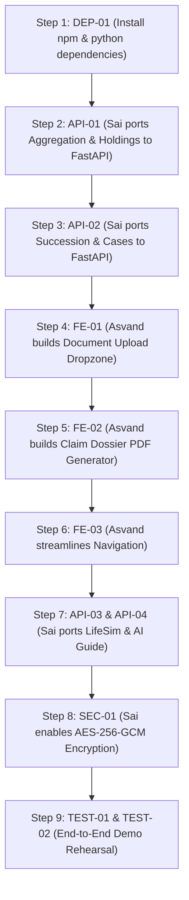

# ASSET BRIDGE — ROUND 2 MASTER REVIEW PACKAGE
# TECHNICAL AUDIT, ARCHITECTURAL BLUEPRINT & IMPLEMENTATION PLAN

**Document ID:** `DOC-ASVAND-MASTER-REVIEW`  
**Author:** Asvand (Product & Frontend Lead Assistant)  
**Team:** FINTASTIC 6 (`DEX26253`)  
**Target:** Dexathon 2026 — Round 2 (Industrial Mentor Evaluation)  
**Date:** November 4, 2026  
**Status:** COMPREHENSIVE MASTER SPECIFICATION FOR IMMEDIATE REVIEW  

---

## PART 1 — CURRENT STATE EVALUATION

### 1.1 What Asset Bridge Currently Is
Asset Bridge is a specialized Indian fintech application engineered to solve the **₹94,000+ crore unclaimed financial asset crisis**. It acts as a financial twin for a citizen during their lifetime (mapping accounts, detecting nominee gaps, calculating taxes, and modeling retirement cash flows) and automatically pivots into an administrative estate succession engine when a death event is registered.

### 1.2 What Actually Works in Code
- **Salted Authentication & Session Security:** `hashlib.scrypt` password hashing and timing-safe HMAC-SHA256 session token signing in `fastapi-backend/app/module1_core/auth.py`.
- **Identity Verification & Multi-Tier Fuzzy Matching:** PAN regex validation and multi-tier name matching (`exact`, `partial`, `mismatch`) in `identity.py`.
- **Deterministic Multi-Regulator Synthetic Engine:** High-performance FNV-1a seeded PRNG generating repeatable, realistic portfolios for any valid Indian PAN across 7 institutions (RBI, EPFO, IRDAI, SEBI, LIC, PFRDA, DOP).
- **Native Duplex WebSockets:** Asynchronous WebSocket hub (`live_manager`) on `/ws` in `live.py`.
- **Mathematical Wealth Simulator:** 1,000-path stochastic Monte Carlo engine with Box-Muller normal distributions, drawdown hierarchies, and Union Budget 2025 Indian tax slab calculations.
- **State-Aware Administrative Succession Engine:** Curated statutory checklists for 10 Indian states tailored by revenue authority (Tahsildar in TN vs. Civil Court in Maharashtra).
- **BM25 Succession Knowledge RAG:** Local BM25 ranking over 8 legal Markdown guides with LLM generation and graceful extractive offline fallback.

### 1.3 What is Simulated
- **External Regulatory Registries:** In the absence of licensed NBFC-AA gateway certificates and closed government APIs (EPFO, CRS), holdings are deterministically simulated via PAN hashing.
- **Account Aggregator Consent Artefacts:** Ingestion simulates ReBIT-compliant consent parameters; it does not connect to the live Sahamati network.
- **Civil Registration System (CRS):** Death registration ingestion is triggered via simulated REST calls (`POST /api/crs/death`).

### 1.4 What is Incomplete or Broken
1. **CRITICAL: Temporary Backend Route Severance (PR #1):** Backend lead Sai migrated Module 1 (Auth, Meta, Identity) to FastAPI and removed the Node server before porting Modules 2–5. As a result, routes `/consents`, `/holdings`, `/alerts`, `/plan`, `/cases`, etc., return 404 until ported.
2. **Missing Document Pipeline:** The original concept promised document validation and claim packet generation. Currently, `CaseBody.tsx` only renders checkboxes. There is no file upload dropzone, no MIME validation, no SHA-256 duplicate hashing, and no PDF claim dossier export.
3. **Plaintext Data Storage:** `db.json` currently stores sensitive PANs, phone numbers, and balances in unencrypted plaintext.

---

## PART 2 — TARGET STATE SPECIFICATION

### 2.1 What the Product Should Become for Round 2
A clean, hardened, and complete product that guides a family through an intuitive 5-step operational journey:
1. **Identity & PAN Verification:** Instant cross-checking across 7 financial institutions.
2. **Consent & Multi-Source Ingestion:** 1-click aggregation combining synthetic discovery with a real CAMS/KFintech statement upload parser.
3. **Consolidated Wealth & Risk Audit:** Interactive dashboard highlighting missing nominees, minor nominees, and inoperative accounts with 1-click resolution.
4. **Estate Succession Case:** Automated breakdown of claims with state-specific revenue paperwork upon death registration.
5. **The Verified Claim Engine:** Heirs upload supporting documents (Death Certificate, KYC), client-side validation detects duplicates and verifies formats, and the user downloads an official, pre-filled **Claim Dossier PDF**.

---

## PART 3 — TECHNICAL ASSESSMENT

- **Frontend Assessment:** React 19 + TypeScript + Vite 8 provides instant rendering and sub-second HMR. Dark/light theme token remapping in `index.css` is clean. The primary need is streamlining the 12 sidebar links down to 5 core operational views and adding the document dropzone.
- **Backend Assessment:** The migration to Python FastAPI (`fastapi-backend/`) is strategically sound because it unifies the web API with the Python NLP/RAG pipeline. However, porting the remaining routes (Modules 2–5) is the immediate blocker.
- **Data Architecture:** The abstracted store (`store.py`) is well-isolated. Adding field-level AES-256-GCM encryption will satisfy DPDP Act 2023 security requirements.
- **AI/RAG Subsystem:** BM25 lexical search over 8 local Markdown files is extremely resilient. The extractive sentence-scoring fallback guarantees answers during evaluation even if external LLM API quotas fail.

---

## PART 4 — MASTER TASK BREAKDOWN & REGISTER SUMMARY

Detailed specifications for each task are established in [TASK_REGISTER.md](asvand/TASK_REGISTER.md):

1. **`DEP-01` (Critical | Owner: Asvand/Sai):** Install workspace dependencies (`npm install` & python `.venv`).
2. **`API-01` (Critical | Owner: Sai):** Port Module 2 (Aggregation, Holdings & Alerts) to FastAPI.
3. **`API-02` (Critical | Owner: Sai):** Port Module 4 (Succession Engine, Cases & CRS) to FastAPI.
4. **`FE-01` (Critical | Owner: Asvand):** Build Document Upload & Validation Dropzone in `CaseBody.tsx`.
5. **`FE-02` (Critical | Owner: Asvand):** Build Pre-Filled Claim Dossier PDF Generator.
6. **`FE-03` (High | Owner: Asvand):** Consolidate Sidebar Navigation from 12 to 5 links.
7. **`API-03` (High | Owner: Sai):** Port Module 3 (LifeSim & Tax Engine) to FastAPI.
8. **`API-04` (High | Owner: Sai):** Port Module 5 (BM25 Knowledge RAG & AI Guide) to FastAPI.
9. **`SEC-01` (High | Owner: Sai):** Implement Transparent AES-256-GCM Storage Encryption.
10. **`PIPE-01` (Medium | Owner: Sai/Asvand):** CAMS/KFintech Statement (CAS) Upload Parser.
11. **`FE-04` (Medium | Owner: Asvand):** Document-to-Record Heuristic Discrepancy Matching UI.

---

## PART 5 — IMPORTANT DECISIONS REQUIRED FROM ASVAND

As Product & Frontend Lead, your explicit approval is required on the following architectural decisions:

1. **Backend Unification vs. Temporary Node Restoration:**  
   *Option A (Recommended):* Commit fully to Sai's FastAPI backend and have Sai port Modules 2–5 from legacy commit `6142819` into `fastapi-backend/app/`.  
   *Option B:* Temporarily restore the Node.js server until Sai finishes all FastAPI modules.  
   *(Recommendation: Option A — porting the clean routes to FastAPI takes ~2 hours and avoids dual-server fragmentation).*
2. **Sidebar Navigation Consolidation:**  
   Approve streamlining the 12 sidebar links into 5 primary groups: Workspace (`/app`), Discovery (`/app/verify`), Life Planning (`/app/plan`), Cases (`/app/cases`), and AI Guide (`/app/guide`).
3. **Document Upload Architecture:**  
   Approve keeping the document upload pipeline 100% client-side for Round 2 (using Web Crypto API SHA-256 hashing and client-side PDF generation) to eliminate file-storage backend latency during live judge demonstrations.

---

## PART 6 — IMPLEMENTATION SEQUENCE (STRICT DEPENDENCY ORDER)

---

## PART 7 — FINAL READINESS & RISK ASSESSMENT

- **Critical Blocker:** Inability to run beyond `/app/verify` until Sai completes `API-01` and `API-02`.
- **Top Differentiator:** Delivering the "Verified Claim Dossier Engine" (`FE-01` + `FE-02`) transforms Asset Bridge from a dashboard into an operational problem solver.
- **Industrial Mentor Preparedness:** With these specifications, our team can answer every architecture, security, scaling, and regulatory question with deep technical defense grounded in the actual codebase.

