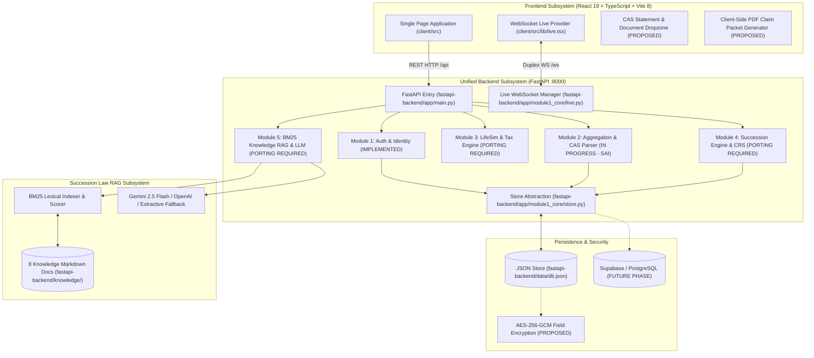
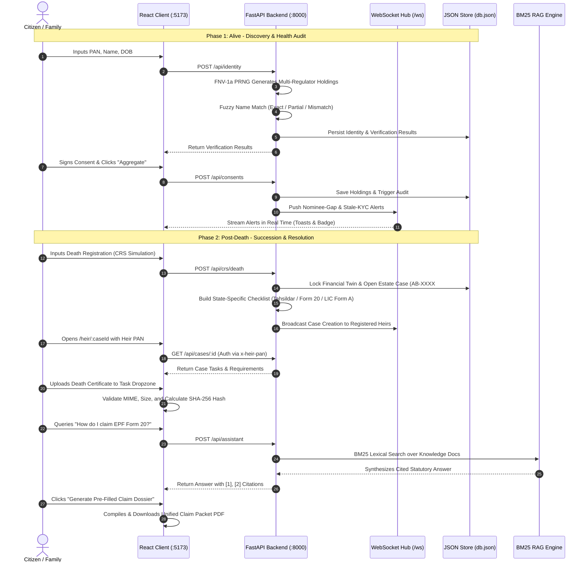

# ASSET BRIDGE — SYSTEM ARCHITECTURE SPECIFICATION
**Document ID:** `DOC-ASVAND-02`  
**Author:** Asvand (Product & Frontend Lead Assistant)  
**Date:** November 4, 2026  
**Status:** ARCHITECTURAL TARGET & TRANSITION BLUEPRINT  

---

## 1. ARCHITECTURAL EVOLUTION (EXISTING VS. TARGET)

The project is currently transitioning from a legacy multi-language prototype (Node.js Express + Python FastAPI) to a unified **Python FastAPI architecture** following backend lead Sai's PR #1 merge (`55afe26`).

---

## 2. SUBSYSTEM-BY-SUBSYSTEM ARCHITECTURAL SPECIFICATION

### A. Frontend Subsystem (`client/`)
- **Technology Stack:** React 19.3.1, TypeScript 7.0.2 / 5.8+, Vite 8.3.5, Tailwind CSS v4.3.3, Motion 14.6.0.
- **State Management:** Local React state with context boundaries (`AuthContext` in `lib/auth.tsx`, `LiveContext` in `lib/live.tsx`, `ThemeContext` in `lib/theme.tsx`). Network data is fetched via typed fetch helpers in `lib/api.ts`.
- **Component Architecture:**
  - *Domain Components:* `CaseBody.tsx` (succession checklist & task execution), `GuideChat.tsx` (AI conversational assistant), `ForecastChart.tsx` (SVG asset class visualizer), `LifeTimeline.tsx` (concentric age ring dial).
  - *Vendored High-Fidelity Libraries:* Aceternity UI (`lamp.tsx`, `glowing-effect.tsx`) and Kokonut UI (`detent-dial.tsx`, `avatar-picker.tsx`).
- **Communication:** Configured in `vite.config.ts` to proxy all `/api` and `/ws` traffic to `http://localhost:8000`.

### B. Backend Subsystem (`fastapi-backend/app/`)
- **Technology Stack:** Python 3.11/3.14, FastAPI 0.115, Uvicorn 0.30, Pydantic v2.7, HTTPX 0.27.
- **Routing Structure:**
  - `main.py`: Entry point; configures CORS middleware (`allow_origins=["*"]`), global exception handlers, OpenAPI metadata, and mounts `module1_core/routers.py`.
  - `module1_core/auth.py`: Password hashing with `hashlib.scrypt(password, salt=salt, n=16384, r=8, p=1, maxmem=0, dklen=64)`. Token signing uses HMAC-SHA256 with timing-safe comparison.
  - `module1_core/identity.py`: PAN format regex validation, deterministic multi-regulator synthetic asset generator using FNV-1a seeded PRNG, and fuzzy name-matching logic.
  - `module1_core/live.py`: WebSocket connection hub maintaining `dict[str, list[WebSocket]]` for live alert broadcasting.
- **Porting Roadmap (Sai's Modules):**
  - *Module 2 (Aggregation & Ingestion):* Port consent models, CAS statement parsing (CAMS/KFintech), holding aggregation, and nominee-gap audit rules (`alertsFor()`).
  - *Module 3 (Wealth Simulator & Tax):* Port 1000-iteration Monte Carlo engine (`mulberry32` PRNG with Box-Muller transforms) and Union Budget 2025 Indian Income Tax slabs.
  - *Module 4 (Succession Engine):* Port multi-state statutory task generator (`STATE_HEIR_DOC`, `BY_REGULATOR`) and CRS death registration ingestion (`POST /api/crs/death`).
  - *Module 5 (AI Guidance):* Integrate BM25 RAG index over `fastapi-backend/knowledge/` with Gemini/OpenAI API calls and local extractive fallback.

### C. Data Persistence Subsystem
- **Current Store:** In-memory dictionary in `fastapi-backend/app/module1_core/store.py`, loaded from and asynchronously persisted to `fastapi-backend/data/db.json` with a 50ms debounce timer.
- **Data Collections:** `users`, `heirs`, `consents`, `holdings`, `alerts`, `cases`, `snapshots`.
- **Security Hardening (Proposed):** Field-level AES-256-GCM encryption for PANs, phone numbers, and financial balances before disk writes.
- **Future Database Path:** Drop-in interface allowing migration to Supabase (PostgreSQL with Row-Level Security) without altering router signatures.

---

## 3. ARCHITECTURAL STATUS CLASSIFICATION

| Layer / Subsystem | Status | Current Reality & Location |
|---|---|---|
| **Auth & Session Management** | **IMPLEMENTED** | FastAPI native endpoints (`/api/auth/*`, `/api/me`) in `fastapi-backend/app/module1_core/routers.py`. |
| **PAN Verification & Matching** | **IMPLEMENTED** | FNV-1a deterministic generator & fuzzy matcher in `fastapi-backend/app/module1_core/identity.py`. |
| **WebSocket Real-Time Broadcast** | **IMPLEMENTED** | `/ws` endpoint in `fastapi-backend/app/main.py` + `fastapi-backend/app/module1_core/live.py`. |
| **Account Aggregator Consent Schema** | **IMPLEMENTED IN NODE (PORT PENDING)** | ReBIT consent artefact logic exists in legacy commit `6142819`; needs FastAPI router port. |
| **CAS Statement Upload Parser** | **IN PROGRESS (SAI)** | Documented in `.planning/ROADMAP.md` Phase 1; parser implementation in progress. |
| **Monte Carlo Life Planner & Tax** | **IMPLEMENTED IN NODE (PORT PENDING)** | Complete mathematical code exists in legacy `lifesim.js` and `tax.js`; needs Python port. |
| **Multi-State Succession Checklists** | **IMPLEMENTED IN NODE (PORT PENDING)** | 10 Indian state rules exist in legacy `succession.js`; needs Python port. |
| **BM25 Succession Knowledge RAG** | **IMPLEMENTED IN STANDALONE (PORT PENDING)** | Code exists in legacy `ai-service/main.py`; needs FastAPI router port. |
| **Document Upload & Client Validation** | **PROPOSED (ASVAND)** | Dropzone and SHA-256 duplicate detection to be built in `client/src/components/CaseBody.tsx`. |
| **Downloadable Claim Packet PDF** | **PROPOSED (ASVAND)** | Client-side claim dossier export to be built in `client/src/components/CaseBody.tsx`. |
| **AES-256-GCM Storage Encryption** | **PROPOSED (SAI / ASVAND)** | Field-level encryption for sensitive columns in `store.py`. |
| **Live External Banking APIs** | **FUTURE / PROPOSED** | Requires licensed NBFC-AA and RBI sandbox access; currently modeled via deterministic PRNG. |

---

## 4. SEQUENCE DIAGRAM: LIFE-TO-DEATH DATA FLOW

