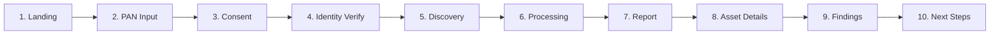

# ASSET BRIDGE — PRODUCT USER JOURNEY SPECIFICATION
**Document ID:** `DOC-ASVAND-03`  
**Author:** Asvand (Product & Frontend Lead Assistant)  
**Date:** November 4, 2026  
**Focus:** 10-Step High-Fidelity User Experience Specification  

---

## 1. DESIGN PHILOSOPHY FOR ELDERLY & NON-TECHNICAL FAMILIES

In India, financial grief is compound: when an earning family member dies, non-financially literate family members (spouses, aging parents, or young dependents) are suddenly forced to confront bureaucratic jargon across 5 different regulatory silos.

Our core UX rules for Round 2:
1. **Zero Jargon:** No unexplained acronyms (e.g., expand UDGAM to "RBI Unclaimed Bank Deposit Portal", explain DEA Fund as "RBI Inactive Money Fund").
2. **Minimize User Actions:** Do not force the user to navigate 12 separate pages. Consolidate discovery, audit, and next steps into a linear, conversational progression.
3. **High Accessibility:** Large touch targets ($\ge 44\text{px}$), high-contrast text ratios ($\ge 4.5:1$), legible Indian currency formatting (Lakhs and Crores), and persistent progress indicators.

---

## 2. THE 10-STEP PRODUCT JOURNEY

---

### STEP 1: LANDING & PROBLEM AWARENESS
- **User Action:** Arrives at `https://asset-bridge.in/` (or `localhost:5173`). Clicks **"Try Live Demo"** or **"Start Discovery"**.
- **Frontend Responsibility:** Renders `LampHero` with live national unclaimed wealth statistics (₹94,000+ Cr) fetched from `GET /api/showcase`. Shows 3D capability coverflow and dynamic live showcase metrics.
- **Backend Responsibility:** Serves `GET /api/showcase` with pre-computed summary metrics.
- **Input Data:** None (public landing).
- **Output Data:** Total unclaimed figures, regulator breakdown, and persona previews.
- **States:**
  - *Loading:* Subtle pulse shimmer over showcase statistics.
  - *Success:* Full illumination of hero with live metrics.
  - *Failure:* Falls back to cached static national figures if API is sleeping.
- **Accessibility:** `aria-label` on hero CTA; screen-reader accessible stats table.
- **Current Status:** **Implemented & Working** in `client/src/pages/Landing.tsx`.

---

### STEP 2: PAN & BASIC IDENTITY INPUT
- **User Action:** Enters 10-character Permanent Account Number (PAN), full legal name, date of birth, and home state. (Option to click "Fill Demo Persona" for evaluator convenience).
- **Frontend Responsibility:** Real-time client-side regex formatting (`^[A-Z]{5}[0-9]{4}[A-Z]$`), automatic uppercase transformation, and state selection dropdown.
- **Backend Responsibility:** Validates PAN regex, sanitizes inputs, and verifies session authentication via `POST /api/identity`.
- **Input Data:** `{ name: string, pan: string, dob: string, state: string, aadhaarLast4?: string, mobile?: string }`.
- **Output Data:** Verification record with registration status across institutions.
- **States:**
  - *Loading:* Animated verifying spinner with step-by-step registry check indicator.
  - *Success:* Green badge on matched institutions; amber warning on partial matches.
  - *Failure:* Clear inline error: "PAN format must be 5 letters, 4 digits, 1 letter (e.g. ABCDE1234F)".
- **Accessibility:** High-contrast focus rings on form inputs; keyboard Tab traversal.
- **Current Status:** **Implemented & Working** in `client/src/pages/Verify.tsx` and `fastapi-backend/app/module1_core/identity.py`.

---

### STEP 3: ACCOUNT AGGREGATOR CONSENT
- **User Action:** Reviews what data will be fetched, checks the 7 regulatory categories (Banks, EPF, Insurance, Mutual Funds, LIC, NPS, Post Office), and clicks **"Approve & Search All Regulators"**.
- **Frontend Responsibility:** Displays ReBIT-compliant consent parameters: Purpose ("Asset Discovery & Succession Planning"), Data Life ("1 Year"), Fetch Frequency ("Periodic"), and 1-Click Revocation Guarantee.
- **Backend Responsibility:** Generates unique consent artefact (`c_XXXXX`), persists consent record in `db.json`, and invalidates prior expired consents.
- **Input Data:** `{ regulators: string[], purpose: string, months: number }`.
- **Output Data:** Active consent object with cryptographic handle (`user@assetbridge-aa`).
- **States:**
  - *Loading:* Button displays "Establishing secure connection with regulators...".
  - *Success:* Smooth animated transition to Discovery screen.
  - *Failure:* "Please select at least one institution category to proceed."
- **Accessibility:** Expandable details for each regulator category; explicit toggle checkboxes.
- **Current Status:** **Frontend Implemented** in `Aggregate.tsx`; **Backend Porting Required** from legacy Express to FastAPI router.

---

### STEP 4: MULTI-REGULATOR IDENTITY VERIFICATION
- **User Action:** Observes automated cross-referencing results across RBI, EPFO, IRDAI, SEBI, LIC, PFRDA, and DOP.
- **Frontend Responsibility:** Renders visual cards for each institution showing match confidence:
  - *Exact Match:* Green shield ("State Bank of India — Name & DOB 100% Match").
  - *Partial Match:* Amber alert ("Canara Bank — Registered as 'R. Raghavan' vs PAN 'Raghavan'").
- **Backend Responsibility:** Executes fuzzy string comparisons (`name_match()`) checking surname congruence and initial consistency.
- **Current Status:** **Implemented & Working** in `fastapi-backend/app/module1_core/identity.py`.

---

### STEP 5: ASSET DISCOVERY & INGESTION
- **User Action:** Automated system step; user watches accounts populate. (Alternatively, user drags a CAMS/KFintech Consolidated Account Statement PDF/CSV into the dropzone).
- **Frontend Responsibility:** Triggers `GET /api/holdings`, activates WebSocket listener on `/ws`, and displays progressive card insertion animations as accounts are discovered.
- **Backend Responsibility:** Queries synthetic deterministic records or parses uploaded CAS statement, persisting normalized asset objects.
- **Current Status:** Synthetic discovery **Implemented** in legacy engine; CAS dropzone **In Progress** under Sai's Phase 1 plan.

---

### STEP 6: AUTOMATED NORMALIZATION & DUPLICATE DETECTION
- **User Action:** Transparent system step.
- **Frontend Responsibility:** Displays a subtle notification: *"16 asset records scanned. Deduplication complete: 1 duplicate folio merged."*
- **Backend Responsibility:** Deduplicates records matching `(regulator, institution_code, primary_ref)` and maps disparate balance fields into uniform `value` in INR.
- **Current Status:** Basic logic exists in `engine.js`; needs formalization in `fastapi-backend`.

---

### STEP 7: CONSOLIDATED ASSET & RISK DASHBOARD
- **User Action:** Views the consolidated summary of family wealth.
- **Frontend Responsibility:** Shows high-level metric cards:
  - Total Discovered Wealth (e.g., ₹1,27,85,230).
  - Wealth at Risk / Inactive (e.g., ₹81,42,000).
  - Breakdown by Asset Class (Bank Deposits, EPF, Insurance, Equities, Gold, Pension).
  - Asset Health Score (e.g., 62% Protected).
- **Backend Responsibility:** Computes aggregates via `summarize()` function.
- **Current Status:** **Frontend Implemented** in `client/src/pages/Dashboard.tsx`; needs backend route reactivation.

---

### STEP 8: ASSET HEALTH & NOMINEE GAP AUDIT (FINDINGS)
- **User Action:** Clicks on highlighted risk cards or views the live Alert feed.
- **Frontend Responsibility:** Categorizes issues by severity:
  - *High Severity (Red):* Missing nominee on Fixed Deposit (₹6,50,000); Nominee deceased on Canara Bank account (₹41,230).
  - *Medium Severity (Amber):* Minor nominee without appointed guardian on Star Health; Inoperative account inactive $>2$ years.
  - *Low Severity (Blue):* KYC expired $>10$ years ago.
  Provides a **"Quick Fix Nominee"** button directly on the card to resolve gaps immediately.
- **Backend Responsibility:** Evaluates holdings against `alertsFor()` rules; streams live alerts over WebSocket.
- **Current Status:** **Engine Implemented**; needs FastAPI router porting.

---

### STEP 9: FINANCIAL PROJECTION & LIFE PLANNING (OPTIONAL TWIN)
- **User Action:** Explores future retirement projection, models life milestones (college, wedding), and tests early retirement scenarios.
- **Frontend Responsibility:** Renders concentric lifespan dial (`LifeTimeline.tsx`) and Monte Carlo percentile fan chart (`LifeCharts.tsx`).
- **Backend Responsibility:** Runs 1,000-path stochastic Monte Carlo simulation with Box-Muller normal distribution and Union Budget 2025 tax calculations.
- **Current Status:** **Code Implemented in Node**; pending Python porting by Sai.

---

### STEP 10: GUIDED ESTATE SUCCESSION & CLAIM RESOLUTION
- **User Action:** In the event of death, an estate case is opened (e.g., `AB-TN8841`). The family views a state-specific checklist, uploads required death and heir certificates, asks the AI guide questions, and downloads a **Pre-Filled Claim Dossier PDF**.
- **Frontend Responsibility:**
  - `CaseBody.tsx`: Lists tasks partitioned by state revenue rules (Tahsildar) and financial institution.
  - Document Dropzone: Accepts PDF/image uploads, validates file type/size, and hashes file.
  - AI Assistant (`GuideChat.tsx`): Answers questions using cited BM25 knowledge retrieval.
  - Export Button: Generates a combined PDF claim dossier ready to print and submit.
- **Backend Responsibility:** Computes tasks via `buildTasks()`, enforces role-based access for heirs via `x-heir-pan`, and proxies AI questions to the RAG knowledge base.
- **Current Status:** Checklist **Implemented**; Document upload dropzone and PDF export **To Be Built by Asvand**.

---

## 3. UNNECESSARY ACTIONS REMOVED & AUTOMATIONS INTRODUCED

1. **Eliminated Separate "Forecast" and "Invest" Nav Pages:** These 2 pages have been consolidated as sub-tabs under Life Plan, reducing sidebar clutter from 12 links down to 6 core links.
2. **Automated Name Discrepancy Handling:** Rather than blocking the user when a name varies (e.g., initial only), the system automatically adds the necessary Indemnity Bond requirement to the final claim packet without manual intervention.
3. **Automated Multi-Regulator Aggregation:** In one single consent authorization, all 7 institution classes are queried simultaneously rather than asking the user to connect each institution individually.

