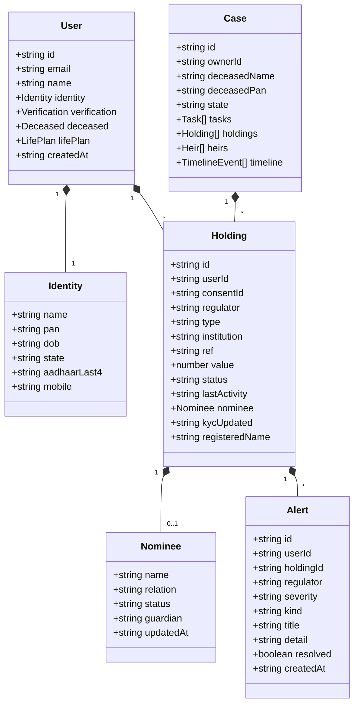

# ASSET BRIDGE — DATA MODELS & TYPE SAFETY SPECIFICATION
**Document ID:** `DOC-ASVAND-06`  
**Author:** Asvand (Product & Frontend Lead Assistant)  
**Date:** November 4, 2026  
**Scope:** TypeScript Frontend Models vs. Python Pydantic Backend Schemas  

---

## 1. CROSS-SUBSYSTEM TYPE SYSTEM ALIGNMENT

To guarantee compile-time type safety across our React/TypeScript frontend and Python FastAPI backend, we must eliminate model discrepancies between `client/src/lib/api.ts` and `fastapi-backend/app/module1_core/identity.py`.



---

## 2. FORMAL DATA CONTRACT DEFINITIONS

### A. User & Identity Schema
```typescript
// client/src/lib/api.ts
export interface Identity {
  name: string;             // Mandatory: Legal name as on PAN card
  pan: string;              // Mandatory: Validated via ^[A-Z]{5}[0-9]{4}[A-Z]$
  dob: string;              // Mandatory: YYYY-MM-DD
  state: string;            // Mandatory: Determines statutory succession authority
  aadhaarLast4?: string;    // Optional: Last 4 digits (e.g., "4821")
  mobile?: string;          // Optional: 10-digit Indian mobile number
}

export interface VerificationCheck {
  ref: string;              // Account or Folio reference (masked)
  institution: string;      // e.g., "State Bank of India", "HDFC Life"
  name: 'exact' | 'partial' | 'mismatch';
  registeredName: string;   // Name on record at institution
  dob: 'exact' | 'mismatch';
}

export interface VerificationResult {
  regulator: 'RBI' | 'EPFO' | 'IRDAI' | 'SEBI' | 'LIC' | 'PFRDA' | 'DOP';
  name: string;             // Full regulatory entity title
  recordsFound: number;
  status: 'verified' | 'partial' | 'mismatch' | 'none';
  checks: VerificationCheck[];
}
```

```python
# fastapi-backend/app/module1_core/identity.py
class IdentityBody(BaseModel):
    name: str
    pan: str
    dob: str
    state: str
    aadhaarLast4: str | None = ""
    mobile: str | None = ""
```

---

### B. Financial Holding Schema (The Unified Asset Representation)
Every asset from every regulator is normalized into this common entity:

```typescript
export interface Nominee {
  name: string;
  relation: 'Spouse' | 'Son' | 'Daughter' | 'Mother' | 'Father' | 'Brother' | 'Sister' | 'Other';
  status: 'valid' | 'deceased' | 'minor';
  guardian?: string | null;  // Required if status === 'minor'
  updatedAt?: string;
}

export interface Holding {
  id: string;                // Primary Key: 'h_XXXXX'
  userId: string;
  consentId: string;
  regulator: 'RBI' | 'EPFO' | 'IRDAI' | 'SEBI' | 'LIC' | 'PFRDA' | 'DOP';
  type: string;              // e.g., 'Savings account', 'EPF account', 'Term life insurance'
  institution: string;       // e.g., 'Canara Bank', 'UAN 1009XXXX7712'
  ref: string;               // e.g., 'XXXX4417', 'POL-77XX1903'
  value: number;             // Indian Rupees (Nominal)
  sip?: number;              // Optional monthly contribution
  status: 'active' | 'inoperative' | 'unclaimed';
  lastActivity: string;      // YYYY-MM-DD
  nominee: Nominee | null;
  kycUpdated: string;        // YYYY-MM-DD
  registeredName?: string;   // Optional if different from identity.name
}
```

---

### C. Nominee-Gap & Integrity Alert Schema
```typescript
export type AlertSeverity = 'high' | 'medium' | 'low';
export type AlertKind = 
  | 'nominee_missing'   // High: No nominee registered on holding
  | 'nominee_deceased'  // High: Nominee on record is deceased
  | 'unclaimed'         // High: Inactive >10 yrs, moved to DEA/Senior Citizens Fund
  | 'nominee_minor'     // Medium: Nominee is a minor with no appointed guardian
  | 'inoperative'       // Medium: Inactive >2 yrs, requires re-KYC
  | 'name_mismatch'     // Medium: Name variation flags claim rejection risk
  | 'kyc_stale';        // Low: KYC older than 10 years

export interface Alert {
  id: string;           // 'a_XXXXX'
  userId: string;
  holdingId: string;
  regulator: string;
  severity: AlertSeverity;
  kind: AlertKind;
  title: string;
  detail: string;
  resolved: boolean;
  resolvedAt?: string | null;
  createdAt: string;
}
```

---

### D. Succession Case & Task Schema
```typescript
export interface Task {
  id: string;           // 't1', 't2'...
  holdingId: string | null; // null for general tasks (e.g. Death Certificate), holding ID for specific asset claims
  title: string;        // e.g., "Submit nominee claim at State Bank of India"
  detail: string;       // Statutory procedure instructions
  docs: string[];       // Required documents, e.g. ["Death certificate", "Claim Form A"]
  authority: string;    // e.g., "Tahsildar (apply via TN e-Sevai)", "EPFO regional office"
  done: boolean;
  uploadedFiles?: {     // PROPOSED for Task FE-01
    name: string;
    size: number;
    hash: string;
    verifiedAt: string;
  }[];
}

export interface Case {
  id: string;           // 'AB-TN8841'
  ownerId: string;
  deceasedName: string;
  deceasedPan: string;
  state: string;
  deceased: {
    dateOfDeath: string;
    registrationNo: string;
    place: string;
  };
  holdings: Holding[];
  heirs: Heir[];
  tasks: Task[];
  timeline: { at: string; text: string }[];
  createdAt: string;
}
```

---

## 3. IDENTIFIED INCONSISTENCIES & RECOMMENDED FIXES

1. **Aadhaar Field Naming:** Backend `IdentityBody` expects `aadhaarLast4` (camelCase) while certain forms in the frontend used `aadhaar_last4` (snake_case). **Fix:** Standardized on `aadhaarLast4` across all models.
2. **Missing `uploadedFiles` Array in Task Interface:** Current frontend `Task` interface does not account for user document attachments. **Fix:** Added optional `uploadedFiles` array to support the new document upload engine.
3. **Pydantic Validation Strictness:** In `fastapi-backend/app/module1_core/routers.py`, optional fields on `IdentityBody` (`aadhaarLast4`, `mobile`) defaulted to `None` which caused `re.match` type errors. **Fix:** Defaulted to empty string `""` with union typing `str | None`.
