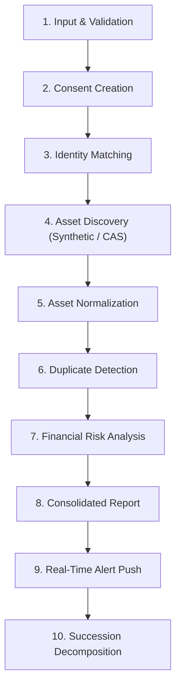

# ASSET BRIDGE — ASSET DISCOVERY & PROCESSING PIPELINE
**Document ID:** `DOC-ASVAND-07`  
**Author:** Asvand (Product & Frontend Lead Assistant)  
**Date:** November 4, 2026  
**Focus:** 10-Stage Data Processing Pipeline Specification  

---

## 1. END-TO-END PIPELINE ARCHITECTURE

---

## 2. STAGE-BY-STAGE PROCESSING SPECIFICATION

### STAGE 1: INPUT & SYNTACTIC VALIDATION
- **Input:** User identity strings (`pan`, `name`, `dob`, `state`, `aadhaarLast4`, `mobile`).
- **Processing Logic:**
  - PAN format check: Regex `^[A-Z]{5}[0-9]{4}[A-Z]$`.
  - 4th character identity validation: In Indian PANs, the 4th character denotes entity type (`P` = Individual, `H` = HUF, `C` = Company). We enforce individual taxpayers (`pan[3] === 'P'`).
  - Aadhaar check: 4 digits (`^\d{4}$`).
- **Output:** Validated `Identity` object.
- **Component Responsible:** `client/src/pages/Verify.tsx` (client) and `fastapi-backend/app/module1_core/routers.py` (`update_identity`).
- **Current Status:** **Implemented & Verified**.
- **Error Conditions:** HTTP 400 with specific field validation message.

---

### STAGE 2: CONSENT CREATION & SCOPE BOUNDING
- **Input:** Selected regulator codes (`['RBI', 'EPFO', 'IRDAI', 'SEBI', 'LIC', 'PFRDA', 'DOP']`), purpose, validity duration.
- **Processing Logic:**
  - Instantiates ReBIT-compliant consent artefact with unique handle (`user@assetbridge-aa`).
  - Revokes any previously active consents for this user to enforce single-active-twin consistency.
- **Output:** Active `Consent` record (`status: 'ACTIVE'`).
- **Component Responsible:** `client/src/pages/Aggregate.tsx` & `POST /api/consents`.
- **Current Status:** **Simulated consent artefact** (porting to FastAPI required).

---

### STAGE 3: MULTI-REGULATOR IDENTITY MATCHING
- **Input:** `Identity` object.
- **Processing Logic:**
  - Executes fuzzy name-matching algorithm (`nameMatch()` in `identity.py`):
    $$\text{Match Grade} = \begin{cases} \text{exact} & \text{if tokens match identically} \\ \text{partial} & \text{if surname matches \& initial is consistent} \\ \text{mismatch} & \text{otherwise} \end{cases}$$
  - Cross-references date of birth (`dob === rec.registeredDob`).
- **Output:** Array of `VerificationResult` containing per-regulator record counts and match grades.
- **Component Responsible:** `fastapi-backend/app/module1_core/identity.py` (`verify_identity()`).
- **Current Status:** **Implemented & Verified**. External registries are currently simulated via deterministic PRNG.

---

### STAGE 4: ASSET DISCOVERY (SYNTHETIC & CAS INGESTION)
- **Input:** Validated consent and PAN.
- **Processing Logic:**
  - *Branch A (Synthetic):* Computes 32-bit FNV-1a hash of the PAN string. Seeds an internal linear congruential generator to deterministically generate realistic holdings across the 7 institutions.
  - *Branch B (Statement Ingestion - Phase 1):* Uploaded CAMS/KFintech CAS statement parsed for mutual fund scheme names, folios, and NAV valuation.
- **Output:** Array of raw asset records.
- **Component Responsible:** `fastapi-backend/app/module1_core/identity.py` (Branch A); Sai's CAS parser in development (Branch B).
- **Current Status:** Synthetic is **Implemented**; CAS parser is **In Progress**.

---

### STAGE 5: ASSET NORMALIZATION
- **Input:** Raw heterogeneous asset objects.
- **Processing Logic:** Normalizes disparate data structures into the unified `Holding` interface:
  - Bank FD principal + accrued interest $\to$ `value`.
  - EPF employee + employer balance $\to$ `value`.
  - Life Insurance sum assured $\to$ `value`.
  - Mutual fund units $\times$ NAV $\to$ `value`.
- **Output:** Normalized `Holding[]` array with uniform fields (`regulator`, `institution`, `ref`, `value`, `status`, `nominee`).
- **Component Responsible:** `engine.js` / `identity.py`.
- **Current Status:** **Implemented**.

---

### STAGE 6: DUPLICATE DETECTION & DEDUPLICATION
- **Input:** Normalized `Holding[]` array.
- **Processing Logic:**
  - Primary key collision check: Any account with identical global identifier (`UAN`, `PRAN`, `Demat BO-ID`, `Folio`) is merged.
  - Secondary heuristic for masked bank accounts: Composite key `(bank_ifsc_prefix, masked_account, registered_name_hash)`.
  - If a duplicate is detected, the newer record's balance and KYC timestamp update the existing entry without creating duplicate records.
- **Output:** Deduplicated asset array.
- **Component Responsible:** `engine.js` / `identity.py`.
- **Current Status:** Basic logic **Implemented**; formal duplicate test suite needed.

---

### STAGE 7: FINANCIAL RISK & INTEGRITY ANALYSIS
- **Input:** Deduplicated `Holding[]` array and user `Identity`.
- **Processing Logic:** Evaluates each asset against statutory risk rules:
  1. *Nominee Missing Rule:* `if holding.nominee is None` $\to$ raise `high` severity alert.
  2. *Nominee Deceased Rule:* `if holding.nominee.status == 'deceased'` $\to$ raise `high` severity alert.
  3. *Minor Nominee Rule:* `if holding.nominee.status == 'minor' and not holding.nominee.guardian` $\to$ raise `medium` severity alert.
  4. *Unclaimed / DEA Fund Rule:* `if holding.status == 'unclaimed'` (inactivity $>10$ yrs) $\to$ raise `high` severity alert.
  5. *Inoperative Account Rule:* `if holding.status == 'inoperative'` (inactivity $>2$ yrs) $\to$ raise `medium` severity alert.
  6. *Stale KYC Rule:* `if yearsSince(holding.kycUpdated) > 10` $\to$ raise `low` severity alert.
- **Output:** `Alert[]` array sorted by severity (`high > medium > low`).
- **Component Responsible:** `server/src/lib/engine.js` (`alertsFor()`); porting to Python required.
- **Current Status:** **Implemented in Node**; pending Python port.

---

### STAGE 8: CONSOLIDATED WEALTH REPORT GENERATION
- **Input:** `Holding[]` and `Alert[]`.
- **Processing Logic:** Aggregates portfolio totals:
  $$\text{Total Discovered Wealth} = \sum \text{holding.value}$$
  $$\text{Wealth at Risk} = \sum_{\text{nominee invalid or account inactive}} \text{holding.value}$$
- **Output:** `Summary` object containing category breakdown, at-risk percentage, and institution counts.
- **Component Responsible:** `summarize()` function.
- **Current Status:** **Implemented**.

---

### STAGE 9: REAL-TIME WEBSOCKET ALERT BROADCASTING
- **Input:** Freshly generated `Alert[]`.
- **Processing Logic:** Staggers alerts at 250ms intervals (`setTimeout`) and dispatches JSON payloads over the active WebSocket connection to the user's active session.
- **Output:** Animated toast notifications and dynamic badge increments on the client.
- **Component Responsible:** `live.py` (`live_manager.broadcast()`).
- **Current Status:** **Implemented & Verified**.

---

### STAGE 10: STATE-AWARE SUCCESSION TASK DECOMPOSITION
- **Input:** Estate holdings and user's residential state.
- **Processing Logic:**
  - Evaluates whether legal heir paperwork is required:
    $$\text{needsHeirDoc} = \exists h \in \text{holdings} : (\text{nominee is None} \lor \text{nominee.status} \neq \text{'valid'})$$
  - Injects state-specific revenue authority requirement (e.g., Tahsildar Legal Heir Certificate in Tamil Nadu vs. District Civil Court Succession Certificate in Maharashtra).
  - Decomposes each asset into regulator-specific forms (EPFO Form 20/10D/5(IF), LIC Claim Form A, SEBI transmission request).
- **Output:** Comprehensive `Task[]` array attached to the estate case `AB-XXXX##`.
- **Component Responsible:** `server/src/data/succession.js` (`buildTasks()`); porting to Python required.
- **Current Status:** **Implemented in Node**; pending Python port.
